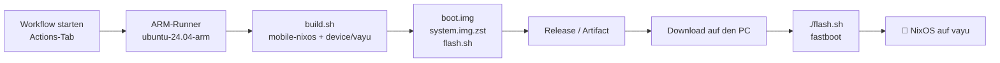

# Mobile NixOS für das Xiaomi POCO X3 Pro (vayu)

🇬🇧 [English version](README.md)

Build-Skripte, Flash-Skript und ein GitHub-Actions-Workflow, der per Klick ein
[Mobile NixOS](https://github.com/mobile-nixos/mobile-nixos)-Image für das
**Xiaomi POCO X3 Pro** (Codename **vayu**, Snapdragon 860 / SM8150) baut.

> ⚠️ **Experimenteller, inoffizieller Port.** vayu wird vom offiziellen Mobile NixOS nicht unterstützt.
> Dieses Repo bringt eine eigene Gerätedefinition mit, basierend auf den Hardwaredaten des
> [postmarketOS-Ports](https://wiki.postmarketos.org/wiki/Xiaomi_POCO_X3_Pro_(xiaomi-vayu))
> (Mainline-Kernel `sm8150-mainline` 6.4, Device Tree `sm8150-xiaomi-vayu`, Firmware-Layout).
> Das Flashen **löscht die userdata-Partition**. Vorher sichern und nur weitermachen,
> wenn du weißt, wie man das Stock-ROM per fastboot zurückspielt.

---

## Inhalt

```
.
├── build.sh                    # baut das Image (lokal, Docker oder CI)
├── flash.sh                    # flasht das Image per fastboot (liegt jedem Build bei)
├── mobile-nixos.rev            # gepinnter mobile-nixos-Commit (reproduzierbare Builds)
├── device/xiaomi-vayu/         # Mobile-NixOS-Gerätedefinition
│   ├── default.nix             #   boot.img-Layout, USB-Gadget, SoC, Firmware
│   ├── kernel/default.nix      #   Kernel-Quelle (sm8150-mainline, gepinnt + sha512)
│   ├── kernel/config.aarch64   #   Kernel-Konfiguration (von postmarketOS)
│   └── firmware/default.nix    #   proprietäre Firmware (GPU, DSP, Modem, WLAN, Touch)
├── config/
│   ├── default.nix             # Einstieg, wählt die Variante
│   ├── common.nix              # Benutzer, Passwort, SSH, Sprache … (hier anpassen!)
│   ├── phosh.nix               # Variante "phosh": Touch-Oberfläche
│   └── minimal.nix             # Variante "minimal": ohne GUI, Debug-Zugang per USB
└── .github/workflows/build.yml # GitHub Actions: Build per Klick
```

## Ablauf im Überblick



---

## 1. Bauen mit GitHub Actions (per Klick)

1. Diesen Ordner in ein GitHub-Repository pushen:
   ```bash
   git init && git add . && git commit -m "Mobile NixOS für vayu"
   git remote add origin git@github.com:<du>/<repo>.git
   git push -u origin main
   ```
2. Auf GitHub: **Actions** → **Build Mobile NixOS (POCO X3 Pro / vayu)** → **Run workflow**.
3. Optionen wählen:

   | Eingabe | Bedeutung |
   |---|---|
   | `variant` | `phosh` (Touch-Oberfläche) oder `minimal` (ohne GUI, zum Inbetriebnehmen/Debuggen) |
   | `mobile_nixos_rev` | leer = Commit aus `mobile-nixos.rev`, oder ein Branch/Commit |
   | `runner` | `ubuntu-24.04-arm` = nativ aarch64, schnell (kostenlos für **öffentliche** Repos). `ubuntu-24.04` = Cross-Compile auf x86, geht überall, dauert aber viele Stunden |
   | `release` | Ergebnis als (Pre-)Release veröffentlichen |

4. Nach dem Lauf (auf dem ARM-Runner ca. 1–2 h, vor allem Kernel und Image):
   - **Releases** → Tag `nixos-vayu-<variante>-<datum>` → alle Dateien herunterladen, oder
   - Seite des Laufs → **Artifacts** (14 Tage aufbewahrt).

> **Privates Repository?** Die ARM-Runner von GitHub sind nur für öffentliche Repos kostenlos.
> Dann `runner: ubuntu-24.04` (langsamer Cross-Build), einen bezahlten Larger Runner oder
> einen eigenen aarch64-Runner (self-hosted, Label im Workflow eintragen) verwenden.

Dateien über 1,9 GB werden in `system.img.zst.part-00, -01, …` aufgeteilt, weil
GitHub-Release-Dateien auf 2 GB begrenzt sind. `flash.sh` setzt sie automatisch zusammen.

## 2. Lokal bauen

Voraussetzungen: [Nix](https://nixos.org/download) (oder Docker/Podman), `git`, `zstd`,
ca. **30–40 GB freier Speicher**.

```bash
./build.sh                  # Variante phosh
./build.sh -v minimal       # Debug-Variante
./build.sh -r development   # neuestes mobile-nixos statt des gepinnten Commits
./build.sh --docker         # ohne lokales Nix: baut im nixos/nix-Container
```

Das Ergebnis liegt in `out/nixos-vayu-<variante>-<datum>/`.

Wie aarch64-Code gebaut wird (`-m/--mode`, Standard `auto`):

| Modus | Wann | Tempo |
|---|---|---|
| `native` | Host ist aarch64 | schnell, fast alles aus cache.nixos.org |
| `emulated` | x86-Host mit `extra-platforms = aarch64-linux` + qemu-binfmt (NixOS: `boot.binfmt.emulatedSystems = [ "aarch64-linux" ];`) | mittel, Cache wird genutzt, Kernel wird emuliert gebaut |
| `cross` | alles andere | langsam, fast alles wird kompiliert |

## 3. Telefon flashen

Voraussetzungen:
- **Entsperrter Bootloader** (Xiaomi Mi Unlock).
- `fastboot` und `zstd` auf dem PC (Arch/Manjaro: `pacman -S android-tools zstd`,
  Debian/Ubuntu/Mint: `apt install fastboot zstd`); optional `img2simg`
  (Paket `android-sdk-libsparse-utils` / `android-tools`) beschleunigt das Flashen.
- Datensicherung – **userdata wird gelöscht**.

Schritte:
1. Telefon ausschalten, **Power + Leiser** gedrückt halten → fastboot-Bildschirm.
2. USB verbinden.
3. Im heruntergeladenen/gebauten Ordner:
   ```bash
   ./flash.sh
   ```
   Das Skript prüft die Prüfsummen, ob das Gerät wirklich `vayu` ist und der Bootloader
   entsperrt ist, fragt nach Bestätigung (`YES`), flasht `boot.img` → `boot` und das
   Root-Dateisystem → `userdata` und startet neu.

Optionen:

| Option | Wirkung |
|---|---|
| `--boot-only` | nur `boot.img` flashen (Kernel/Initrd-Update, Daten bleiben) |
| `--test-boot` | `fastboot boot boot.img` – einmalig aus dem RAM starten, nichts wird geschrieben |
| `--erase-dtbo` | `dtbo`-Partition löschen (versuchen, wenn es immer wieder in fastboot landet) |
| `--recovery` | zusätzlich `recovery.img` flashen (ersetzt TWRP/OrangeFox) |
| `--no-reboot` | in fastboot bleiben |
| `--force` | Geräteprüfung überspringen |
| `-y` | ohne Rückfrage |
| `-d DIR` | Ordner mit den Images |

**Anmeldung:** Benutzer `nixos`, Passwort/PIN `1234` → sofort mit `passwd` ändern.
Beim ersten Start wird das Root-Dateisystem auf die volle Größe von userdata vergrößert, das kann etwas dauern.

### Zurück zu Android / Ubuntu Touch
Ein Xiaomi-fastboot-ROM für vayu flashen (`flash_all.sh` bzw. Mi Flash Tool) oder
Ubuntu Touch mit dessen Installer neu aufspielen. Wurde `--erase-dtbo` verwendet,
stellt das fastboot-ROM auch `dtbo` wieder her.

---

## 4. Anpassen

- **Benutzer, Passwort, SSH-Key, Sprache:** `config/common.nix`
  (`openssh.authorizedKeys.keys` für SSH ohne Passwort).
- **Pakete / Dienste:** NixOS-Optionen in `config/common.nix` oder einer Varianten-Datei ergänzen.
- **Neue Variante:** `config/<name>.nix` anlegen, mit `./build.sh -v <name>` bauen und den
  Namen in `.github/workflows/build.yml` bei den `variant`-Optionen ergänzen.
- **mobile-nixos aktualisieren:** neuen Commit in `mobile-nixos.rev` eintragen
  (vorher mit `-r <commit>` bzw. der Workflow-Eingabe testen).
- **Kernel:** `device/xiaomi-vayu/kernel/default.nix` (Quelle + sha512) und `config.aarch64`.
  Die Werte folgen postmarketOS' `linux-postmarketos-qcom-sm8150`; wenn pmaports dort
  aktualisiert, Commit, Hash und Config von dort übernehmen.

Nach dem ersten Start lässt sich das System auch direkt auf dem Telefon mit einer
normalen NixOS-Konfiguration ändern – oder man baut das Image neu und flasht mit
`--boot-only` bzw. komplett.

## 5. Status & Fehlersuche

Was zu erwarten ist (abgeleitet vom postmarketOS-Port; **dieser NixOS-Build ist noch
nicht auf echter Hardware getestet**): Anzeige über simple-framebuffer, Touchscreen, USB,
Tasten; WLAN/GPU/Modem hängen vom Stand von Firmware und Kernel ab. Bluetooth-Firmware
ist nicht enthalten. Kamera, Audio und Telefonie funktionieren eher nicht.

| Problem | Versuch |
|---|---|
| Bootloop zurück in fastboot | `./flash.sh --boot-only --erase-dtbo` |
| Schwarzer Bildschirm / hängt beim Booten | mit `-v minimal` bauen, per USB verbinden: Host `ip addr add 172.16.42.2/24 dev <usb-iface>`, dann `ssh root@172.16.42.1` (Stage-1, ohne Passwort!) |
| Kernel baut nicht mit neuerem Compiler | älteren `mobile-nixos.rev` pinnen (älteres nixpkgs/GCC) oder Kernel-Commit aktualisieren |
| ARM-Runner nicht verfügbar | `runner: ubuntu-24.04` oder self-hosted Runner verwenden |
| Speicher voll in der CI | der Workflow räumt bereits ca. 20 GB frei; `minimal` oder größeren Runner nutzen |

## Danksagung & Lizenzen

- [Mobile NixOS](https://github.com/mobile-nixos/mobile-nixos) (MIT)
- [postmarketOS pmaports](https://gitlab.com/postmarketOS/pmaports) – Gerätedaten für vayu
- [sm8150-mainline/linux](https://gitlab.com/sm8150-mainline/linux) (GPL-2.0)
- [adomerle/firmware-xiaomi-vayu](https://gitlab.com/adomerle/firmware-xiaomi-vayu) – proprietäre Firmware ohne Weitergabelizenz. Das gebaute `system.img` enthält sie, ein öffentliches Release verteilt sie also weiter; mit `release: false` lässt sich das vermeiden.
