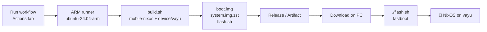

# Mobile NixOS for the Xiaomi POCO X3 Pro (vayu)

🇩🇪 [Deutsche Version](README.de.md)

Build scripts, flash script and a one-click GitHub Actions workflow that produce a
[Mobile NixOS](https://github.com/mobile-nixos/mobile-nixos) image for the
**Xiaomi POCO X3 Pro** (codename **vayu**, Snapdragon 860 / SM8150).

> ⚠️ **Experimental, unofficial port.** vayu is not supported by upstream Mobile NixOS.
> This repo adds its own device definition, based on the hardware data of the
> [postmarketOS port](https://wiki.postmarketos.org/wiki/Xiaomi_POCO_X3_Pro_(xiaomi-vayu))
> (mainline kernel `sm8150-mainline` 6.4, device tree `sm8150-xiaomi-vayu`, firmware layout).
> Flashing **erases the userdata partition**. Make a backup and only continue if you
> know how to restore the stock ROM with fastboot.

---

## Contents

```
.
├── build.sh                    # builds the image (local, docker or CI)
├── flash.sh                    # flashes the image via fastboot (copied into every build)
├── mobile-nixos.rev            # pinned mobile-nixos commit (reproducible builds)
├── device/xiaomi-vayu/         # Mobile NixOS device definition
│   ├── default.nix             #   boot.img layout, USB gadget, SoC, firmware
│   ├── kernel/default.nix      #   kernel source (sm8150-mainline, pinned + sha512)
│   ├── kernel/config.aarch64   #   kernel config (from postmarketOS)
│   └── firmware/default.nix    #   proprietary firmware (GPU, DSP, modem, WiFi, touch)
├── config/
│   ├── default.nix             # entry point, selects the variant
│   ├── common.nix              # user, password, SSH, locale … (edit here!)
│   ├── phosh.nix               # variant "phosh": touch UI
│   └── minimal.nix             # variant "minimal": no GUI, debug access via USB
└── .github/workflows/build.yml # GitHub Actions: build per click
```

## Workflow overview



---

## 1. Build with GitHub Actions (one click)

1. Push this folder to a GitHub repository:
   ```bash
   git init && git add . && git commit -m "Mobile NixOS for vayu"
   git remote add origin git@github.com:<you>/<repo>.git
   git push -u origin main
   ```
2. On GitHub: **Actions** → **Build Mobile NixOS (POCO X3 Pro / vayu)** → **Run workflow**.
3. Choose the options:

   | Input | Meaning |
   |---|---|
   | `variant` | `phosh` (touch UI) or `minimal` (no GUI, for bring-up/debugging) |
   | `mobile_nixos_rev` | empty = commit from `mobile-nixos.rev`, or a branch/commit |
   | `runner` | `ubuntu-24.04-arm` = native aarch64, fast (free for **public** repos). `ubuntu-24.04` = cross-compile on x86, works everywhere but takes many hours |
   | `release` | publish the result as a (pre-)release |

4. After the run (roughly 1–2 h on the ARM runner, mostly the kernel and image build):
   - **Releases** → tag `nixos-vayu-<variant>-<date>` → download all files, or
   - the run page → **Artifacts** (kept for 14 days).

> **Private repository?** GitHub's ARM runners are free only for public repos.
> Use `runner: ubuntu-24.04` (slow cross build), a paid larger runner, or a
> self-hosted aarch64 runner (enter its label in the workflow).

Files bigger than 1.9 GB are split into `system.img.zst.part-00, -01, …` because
GitHub release assets are limited to 2 GB. `flash.sh` joins them automatically.

## 2. Build locally

Requirements: [Nix](https://nixos.org/download) (or Docker/Podman), `git`, `zstd`,
about **30–40 GB free disk space**.

```bash
./build.sh                  # variant phosh
./build.sh -v minimal       # debug variant
./build.sh -r development   # newest mobile-nixos instead of the pinned commit
./build.sh --docker         # no local Nix: builds inside the nixos/nix container
```

The output lands in `out/nixos-vayu-<variant>-<date>/`.

How aarch64 code is built (`-m/--mode`, default `auto`):

| Mode | When | Speed |
|---|---|---|
| `native` | host is aarch64 | fast, almost everything from cache.nixos.org |
| `emulated` | x86 host with `extra-platforms = aarch64-linux` + qemu binfmt (NixOS: `boot.binfmt.emulatedSystems = [ "aarch64-linux" ];`) | medium, cache is used, kernel is compiled emulated |
| `cross` | everything else | slow, almost everything is compiled |

## 3. Flash the phone

Requirements:
- **Unlocked bootloader** (Xiaomi Mi Unlock).
- `fastboot` and `zstd` on the PC (Arch/Manjaro: `pacman -S android-tools zstd`,
  Debian/Ubuntu/Mint: `apt install fastboot zstd`); optional `img2simg`
  (package `android-sdk-libsparse-utils` / `android-tools`) speeds up flashing.
- Backup of your data — **userdata is erased**.

Steps:
1. Turn the phone off, hold **Power + Volume-Down** → fastboot screen.
2. Connect USB.
3. In the downloaded/built folder:
   ```bash
   ./flash.sh
   ```
   The script verifies the checksums, checks that the device really is `vayu`
   and the bootloader is unlocked, asks for confirmation (`YES`), flashes
   `boot.img` → `boot` and the root filesystem → `userdata`, then reboots.

Options:

| Option | Effect |
|---|---|
| `--boot-only` | only flash `boot.img` (kernel/initrd update, data is kept) |
| `--test-boot` | `fastboot boot boot.img` – boot once from RAM, nothing is written |
| `--erase-dtbo` | erase the `dtbo` partition (try this if it bootloops back to fastboot) |
| `--recovery` | also flash `recovery.img` (replaces TWRP/OrangeFox) |
| `--no-reboot` | stay in fastboot |
| `--force` | skip the device check |
| `-y` | no confirmation prompt |
| `-d DIR` | folder with the images |

**Login:** user `nixos`, password/PIN `1234` → change it immediately with `passwd`.
On first boot the root filesystem grows to the full size of userdata, which can take a moment.

### Back to Android / Ubuntu Touch
Flash a Xiaomi fastboot ROM for vayu (`flash_all.bat`/`flash_all.sh` or Mi Flash Tool),
or reinstall Ubuntu Touch with its installer. If you used `--erase-dtbo`, the
fastboot ROM restores `dtbo` as well.

---

## 4. Customize

- **User, password, SSH key, locale:** `config/common.nix`
  (`openssh.authorizedKeys.keys` for password-less SSH).
- **Packages / services:** add NixOS options to `config/common.nix` or a variant file.
- **New variant:** create `config/<name>.nix`, build with `./build.sh -v <name>`
  and add the name to the `variant` options in `.github/workflows/build.yml`.
- **Update mobile-nixos:** write a new commit into `mobile-nixos.rev`
  (or try it first with `-r <commit>` / the workflow input).
- **Kernel:** `device/xiaomi-vayu/kernel/default.nix` (source + sha512) and `config.aarch64`.
  The values follow postmarketOS' `linux-postmarketos-qcom-sm8150`; when pmaports
  updates it, copy commit, hash and config from there.

After the first boot, the system can be changed directly on the phone with a normal
NixOS configuration – or you rebuild the image and use `--boot-only` / full flash.

## 5. Status & troubleshooting

What can be expected (based on the postmarketOS port; **this NixOS build has not
been tested on hardware yet**): display via simple-framebuffer, touchscreen, USB,
buttons; WiFi/GPU/modem depend on the firmware and kernel state. Bluetooth firmware
is not included. Camera, audio and calls are unlikely to work.

| Problem | Try |
|---|---|
| Bootloop back into fastboot | `./flash.sh --boot-only --erase-dtbo` |
| Black screen / stuck at boot | build `-v minimal`, connect via USB: host `ip addr add 172.16.42.2/24 dev <usb-iface>`, then `ssh root@172.16.42.1` (stage-1, no password!) |
| Kernel fails to build with a newer compiler | pin an older `mobile-nixos.rev` (older nixpkgs/GCC) or update the kernel commit |
| `cachix/install-nix-action` / ARM runner unavailable | use `runner: ubuntu-24.04` or a self-hosted runner |
| Disk full in CI | the workflow already frees ~20 GB; use `minimal` or a bigger runner |

## Credits & licenses

- [Mobile NixOS](https://github.com/mobile-nixos/mobile-nixos) (MIT)
- [postmarketOS pmaports](https://gitlab.com/postmarketOS/pmaports) – device data for vayu
- [sm8150-mainline/linux](https://gitlab.com/sm8150-mainline/linux) (GPL-2.0)
- [adomerle/firmware-xiaomi-vayu](https://gitlab.com/adomerle/firmware-xiaomi-vayu) – proprietary firmware without a redistribution license. The built `system.img` contains it, so a public release redistributes it; set `release: false` if you want to avoid that.
